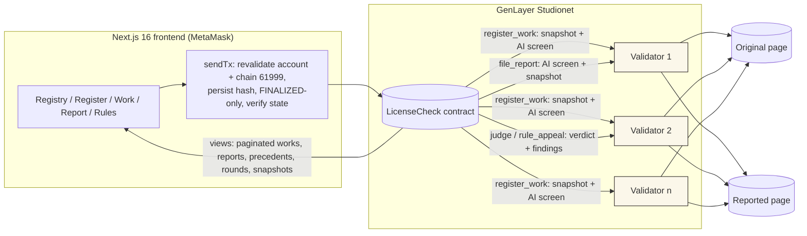
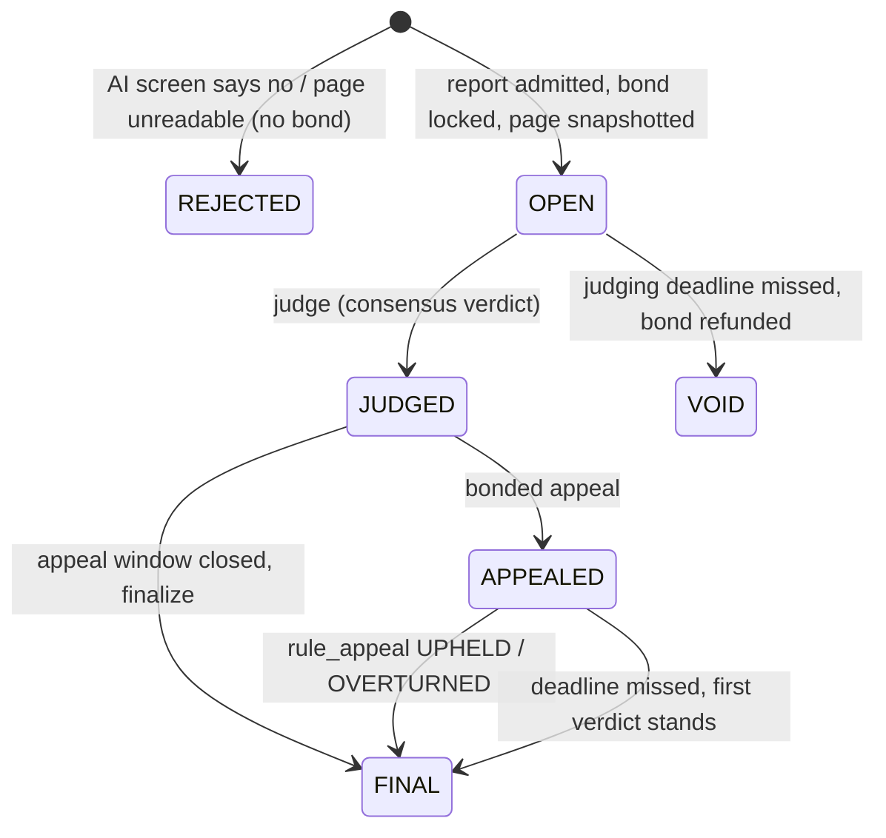

# LicenseCheck

**A public license registry on GenLayer.** Creators register a work (title, canonical URL of the original, a structured
license such as CC BY, CC BY-NC, CC BY-ND or all-rights-reserved, plus optional custom clauses), locked at registration
with a consensus snapshot of the original. Anyone can file a **bonded misuse report**: the reported URL plus the exact
term claimed to be broken. GenLayer AI validators fetch both pages and judge **VIOLATION / COMPLIANT / INCONCLUSIVE**
for that term with structured, verbatim-quoted findings. A bonded appeal with explicit finality follows, and every
outcome is stored on-chain as a public **precedent registry per work**.

> Points are non-monetary registry points with no value. Verdicts are machine readings of public pages: **not legal advice**.

| | |
|---|---|
| Live app | https://licensecheck-dikacreams-projects.vercel.app |
| Contract (Studionet, chain 61999) | [`0x9e2885d91a1F9A426ceEd1580863840395CC109c`](https://explorer-studio.genlayer.com/address/0x9e2885d91a1F9A426ceEd1580863840395CC109c) |
| Deploy tx | [`0x8da3bf24…5f46`](https://explorer-studio.genlayer.com/transactions/0x8da3bf24024a1dae372e263d0154ddd7d0213256ddacf24f9828c1e418de5f46) |
| On-chain e2e results | [`deployments/RESULTS.md`](deployments/RESULTS.md) |
| Deployed-source fingerprint | [`deployments/verification.json`](deployments/verification.json) |
| Browser-originated demo | [`deployments/browser-demo.json`](deployments/browser-demo.json) |
| Trust model | [`docs/TRUST_MODEL.md`](docs/TRUST_MODEL.md) |

## Why GenLayer

Deciding whether a web page breaks a license term ("is the creator credited?", "is this commercial use?", "is this a
modified version?") needs someone to **read two pages and apply a rule written in English**. The alternatives:

| Approach | What goes wrong |
|---|---|
| Price-style oracle | Oracles deliver numbers from APIs. There is no API for "does this page credit Mira Okafor"; the oracle operator would be the judge. |
| Plain smart contract | Cannot fetch web pages or read natural language. At best it stores claims nobody checked. |
| Admin / moderator | One trusted party decides, can be bribed or go away, and its reasons are not reproducible. |
| Single AI call off-chain | One model, one run, one operator: unverifiable, easy to prompt-inject, and the operator can swap pages or answers. |
| **GenLayer** | Several independent validators fetch the same pages and run their own model. The leader's verdict is accepted only if validators re-derive it: same snapshot bytes, same verdict, same term answer, verbatim quotes, no contradictory reading of the decisive passage. Outcomes, snapshots and findings are on-chain and replayable. |

## How it works





Key rules (details and tests in [`docs/TRUST_MODEL.md`](docs/TRUST_MODEL.md)):

* **Licenses → terms:** CC-BY (attribution), CC-BY-SA (+share-alike), CC-BY-NC (+non-commercial), CC-BY-ND (+no
  derivatives), CC-BY-NC-ND, ALL-RIGHTS-RESERVED (no reuse), plus `CUSTOM_n` clauses. Each term has a yes/no question
  and a violating answer.
* **Snapshots:** sha256 of normalized text + the full stored text (≤ 12,000 chars, truncation flagged); validators must
  produce byte-equal rows. Changed pages are judged from stored text; incomplete evidence forces INCONCLUSIVE.
* **Findings:** `{source, url, quote, fact, supports}` (max 4), verbatim, re-derived by validators.
* **Exact URL identity:** fragments dropped, host lowercased, path and query exact. Never substring checks.
* **Appeal finality:** first verdict stands unless revised; unpursued appeal forfeits the bond; recorded consensus
  failure returns it.
* **Points:** `balances + escrow + pool == minted`, checked on-chain (`get_stats().conserved`).

## Repository

```
contracts/licensecheck.py      the intelligent contract (one gl.Contract)
tests/direct/                  direct-mode pytest suite (mocked web + LLM)
scripts/deploy.mjs             deploy to Studionet (wallet from .env)
scripts/e2e.mjs                on-chain scenarios -> deployments/e2e-*.json
scripts/verify-deployment.mjs  sha256 of deployed code vs repo commit -> deployments/verification.json
scripts/browser-demo.mjs       headless browser + node-side EIP-1193 signer against the live site
docs/evidence/                 stable raw-GitHub fixtures used by e2e (Wikipedia is unreliable for consensus)
frontend/                      Next.js 16 + Tailwind 4 + MetaMask
```

## Run and test

```bash
# contract
python -m venv .venv && . .venv/bin/activate && pip install -r requirements.txt
genvm-lint check contracts/licensecheck.py
pytest tests/direct -q

# deploy + e2e (Studionet is gasless; never commit .env)
npm install
cp .env.example .env   # PRIVATE_KEY=0x... (npm run wallet:new creates one)
npm run deploy:studionet
node scripts/e2e.mjs violation      # see the header of scripts/e2e.mjs for all scenarios
node scripts/verify-deployment.mjs --commit <sha> --write

# frontend
cd frontend && npm install
echo NEXT_PUBLIC_CONTRACT_ADDRESS=0x9e2885d91a1F9A426ceEd1580863840395CC109c > .env.local
npm run dev
```

CI (`.github/workflows/ci.yml`) runs genvm-lint, the direct tests and the frontend type-check + build on every push.

## License

MIT. The evidence fixtures under `docs/evidence/` are fictional texts written for testing.
